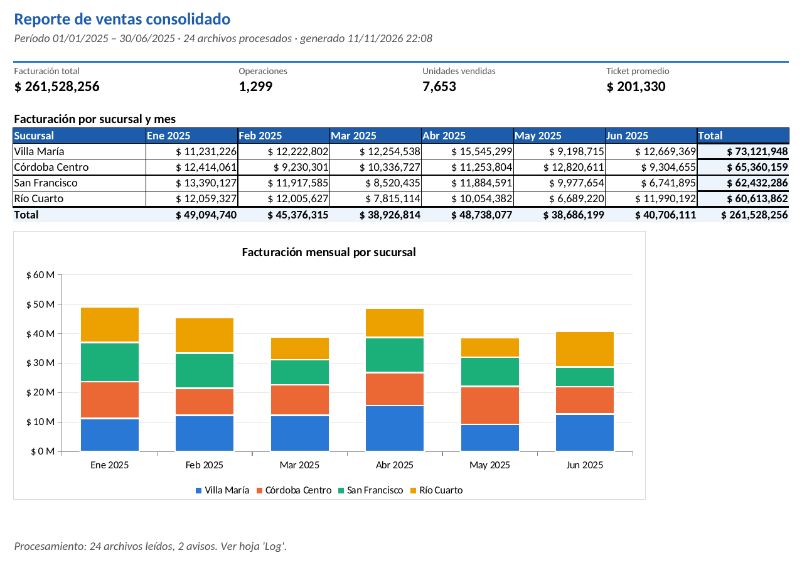

# Automatización de reportes de ventas en Excel

🇬🇧 [Read this in English](README.md)

Script en Python que reemplaza una tarea manual de horas: **juntar las planillas de ventas de varias sucursales y armar el reporte mensual para gerencia**. Se ejecuta con un comando y tarda segundos.

> **Caso de portfolio con datos simulados.** La distribuidora y sus planillas son ficticias, pero reproducen los problemas típicos de planillas armadas a mano.



## El problema

Una distribuidora con 4 sucursales en Córdoba recibe todos los meses una planilla de cada una. Cada sucursal la arma a su manera:

| Problema | Ejemplo |
|---|---|
| Columnas con nombres distintos | `Importe`, `total`, `MONTO ($)`, `Total venta` |
| Títulos y filas vacías antes de la tabla | El encabezado está en la fila 1, 2, 3 o 4 según la sucursal |
| Fila de `TOTAL` al final | Si se suma, la facturación sale duplicada |
| Montos como número o como texto | `14355.31` en una planilla, `$ 1.234,50` en otra |
| Filas vacías en el medio | Alguien borró el contenido pero no la fila |
| Errores de carga | Una venta con cantidad 0 |
| Archivos repetidos | La misma planilla enviada dos veces, con otro nombre |

Juntar todo a mano lleva horas y es fácil equivocarse.

## La solución

```bash
python generar_reporte.py --entrada entrada --salida reporte_ventas.xlsx
```

El script:

1. **Lee todos los Excel** de la carpeta e ignora los temporales que crea Excel (`~$...`).
2. **Detecta dónde empieza la tabla**, aunque haya títulos arriba.
3. **Unifica las columnas** con un diccionario de sinónimos fácil de ampliar.
4. **Limpia** filas vacías, filas de TOTAL, montos en formato argentino y fechas en cualquier formato (incluidas las que Excel guarda como número).
5. **Valida** fechas, cantidades y que total = cantidad × precio.
6. **Detecta archivos repetidos**, tanto copias exactas como dos versiones del mismo período de una sucursal, y carga cada período una sola vez.
7. **Genera el reporte** en Excel con:
   - **Resumen:** indicadores, tabla sucursal × mes con fórmulas reales y gráfico nativo de Excel. Entra en una hoja para imprimir.
   - **Sucursales, Vendedores y Productos:** rankings como tablas de Excel con filtros.
   - **Datos:** todas las ventas consolidadas, con el archivo de origen de cada una.
   - **Log:** qué pasó con cada archivo y qué problemas se encontraron.

En los datos de ejemplo, la carpeta tiene 25 archivos: el script procesa 24, omite una copia exacta (la planilla de Villa María de febrero enviada dos veces) y consolida 1.299 ventas. También excluye una venta con cantidad 0. Ambos casos quedan registrados en el log en lugar de fallar o sumar de más.

### Decisiones de diseño

- **Los duplicados se buscan por archivo, no por venta.** Dos ventas idénticas el mismo día pueden ser legítimas; un archivo idéntico enviado dos veces, no.
- **Si llegan dos versiones distintas del mismo período**, se carga la primera y se avisa en el log para que una persona decida cuál es la correcta. El script no elige solo.
- **Cuando total ≠ cantidad × precio, se conserva el total informado** y se avisa, porque puede haber descuentos.
- **El resumen usa fórmulas de Excel** (`=SUMA(...)`) en vez de valores fijos, para que el cliente pueda auditar los números.

## Estructura

```
├── generar_reporte.py       # el script principal
├── generar_ejemplos.py      # crea las planillas de ejemplo en entrada/
├── entrada/                 # 25 archivos de 4 sucursales (24 planillas + 1 copia), ene-jun 2025
├── reporte_ventas.xlsx      # reporte generado de ejemplo
├── tests/test_generar_reporte.py
├── docs/captura_resumen.png
└── requirements.txt
```

## Cómo usarlo

Requiere Python 3.11+ (las versiones fijadas en `requirements.txt` se probaron con Python 3.14).

```bash
python -m venv .venv
.venv\Scripts\activate           # en Linux/macOS: source .venv/bin/activate
pip install -r requirements.txt
python generar_ejemplos.py      # opcional: regenera las planillas de ejemplo
python generar_reporte.py       # usa entrada/ y genera reporte_ventas.xlsx
pytest -q                       # corre los tests
```

Para adaptarlo a otra empresa:
- Agregar sus nombres de columna al diccionario `SINONIMOS`.
- Nombrar los archivos como `ventas_<sucursal>_<año>_<mes>.xlsx`.
- Opcionalmente, cargar los nombres para mostrar en `NOMBRES_SUCURSALES`.

**Herramientas:** Python, pandas, openpyxl, XlsxWriter, pytest.

## Licencia

[MIT](LICENSE) © 2026 Bruno
