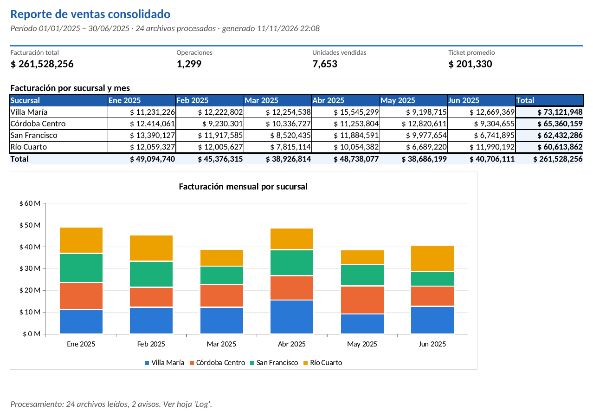

# Sales Report Automation in Excel

🇪🇸 [Leer en español](README.es.md)

A Python script that replaces a manual, hours-long task: **merging the sales spreadsheets of several branches into the monthly management report**. One command, a few seconds.

> **Portfolio case with simulated data.** The distributor and its spreadsheets are fictional, but they reproduce the typical problems of hand-built spreadsheets. The report text and sheet names are in Spanish.



## The problem

A distributor with 4 branches in Córdoba, Argentina, receives one spreadsheet per branch every month. Each branch builds it its own way:

| Problem | Example |
|---|---|
| Different column names | `Importe`, `total`, `MONTO ($)`, `Total venta` |
| Titles and blank rows above the table | The header is on row 1, 2, 3 or 4 depending on the branch |
| A `TOTAL` row at the bottom | Summing everything double-counts revenue |
| Amounts as numbers or as text | `14355.31` in one file, `$ 1.234,50` in another |
| Blank rows in the middle | Someone cleared the content but not the row |
| Data-entry errors | A sale with quantity 0 |
| Repeated files | The same spreadsheet sent twice under another name |

Merging by hand takes hours and is easy to get wrong.

## The solution

```bash
python generar_reporte.py --entrada entrada --salida reporte_ventas.xlsx
```

The script:

1. **Reads every Excel file** in the folder and ignores Excel's temporary files (`~$...`).
2. **Finds where the table starts**, even with titles above it.
3. **Unifies column names** using an easy-to-extend synonym dictionary.
4. **Cleans** blank rows, TOTAL rows, Argentine-format amounts and dates in any format (including dates Excel stores as numbers).
5. **Validates** dates, quantities, and that total = quantity × unit price.
6. **Detects repeated files**, both exact copies and two versions of the same branch and period, and loads each period only once.
7. **Generates the Excel report** with:
   - **Resumen (Summary):** KPIs, a branch × month table with real formulas, and a native Excel chart. Fits on one printed page.
   - **Sucursales, Vendedores, Productos:** rankings as filterable Excel tables.
   - **Datos:** all consolidated sales, with the source file of each one.
   - **Log:** what happened to each file and which problems were found.

On the sample data the folder holds 25 files. The script processes 24, skips one exact copy (the February Villa María spreadsheet sent twice) and consolidates 1,299 sales. It also excludes one sale with quantity 0. Both cases are recorded in the log instead of crashing or double-counting.

### Design decisions

- **Duplicates are detected per file, not per sale.** Two identical sales on the same day can be legitimate; an identical file sent twice cannot.
- **If two different versions of the same period arrive,** the first one is loaded and a warning goes to the log so a person can decide which is correct. The script does not pick by itself.
- **When total ≠ quantity × price, the reported total is kept** and a warning is logged, since discounts are possible.
- **The summary uses Excel formulas** (`=SUM(...)`) instead of fixed values, so the client can audit the numbers.

## Project structure

```
├── generar_reporte.py       # main script
├── generar_ejemplos.py      # creates the sample spreadsheets in entrada/
├── entrada/                 # 25 files from 4 branches (24 spreadsheets + 1 copy), Jan-Jun 2025
├── reporte_ventas.xlsx      # sample generated report
├── tests/test_generar_reporte.py
├── docs/captura_resumen.png
├── requirements.txt
└── LICENSE
```

## Usage

Requires Python 3.10 or newer (the pinned versions in `requirements.txt` were tested with Python 3.14).

```bash
python -m venv .venv
.venv\Scripts\activate           # Linux/macOS: source .venv/bin/activate
pip install -r requirements.txt
python generar_ejemplos.py      # optional: regenerate the sample spreadsheets
python generar_reporte.py       # reads entrada/ and writes reporte_ventas.xlsx
pytest -q                       # run the tests (24)
```

To adapt it to another company:
- Add its column names to the `SINONIMOS` dictionary.
- Name the files `ventas_<branch>_<year>_<month>.xlsx`.
- Optionally add display names to `NOMBRES_SUCURSALES`.

**Tools:** Python, pandas, openpyxl, XlsxWriter, pytest.

## License

[MIT](LICENSE) © 2026 Bruno
